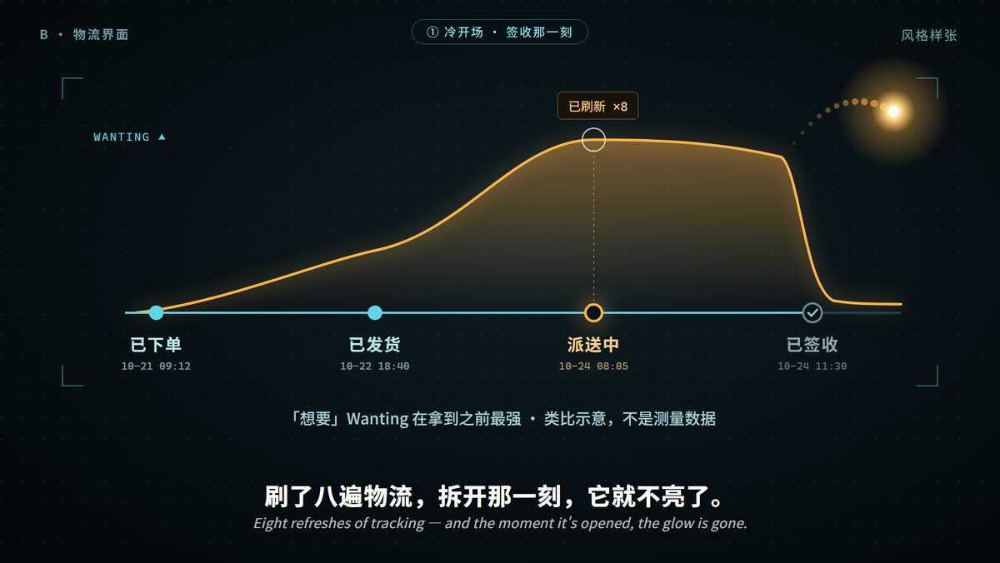
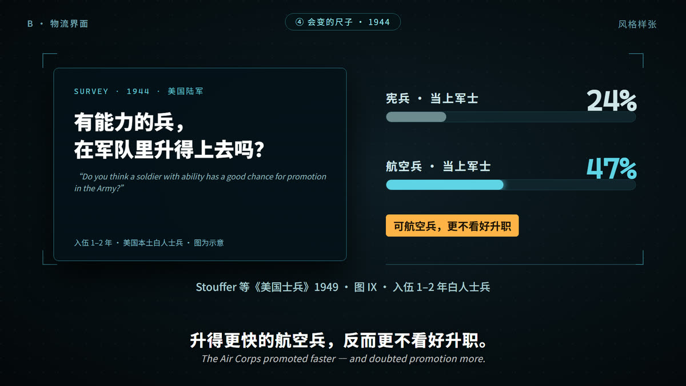
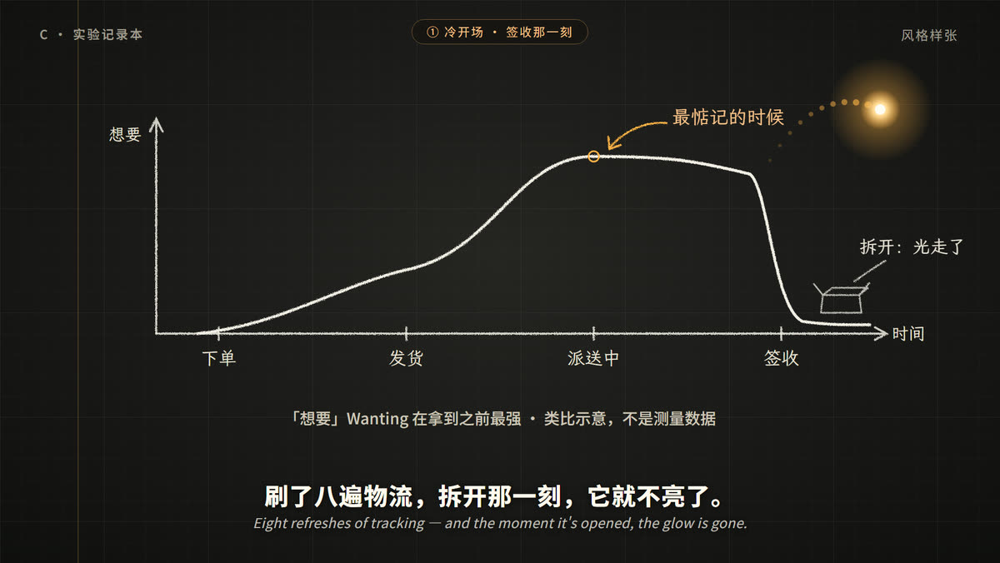
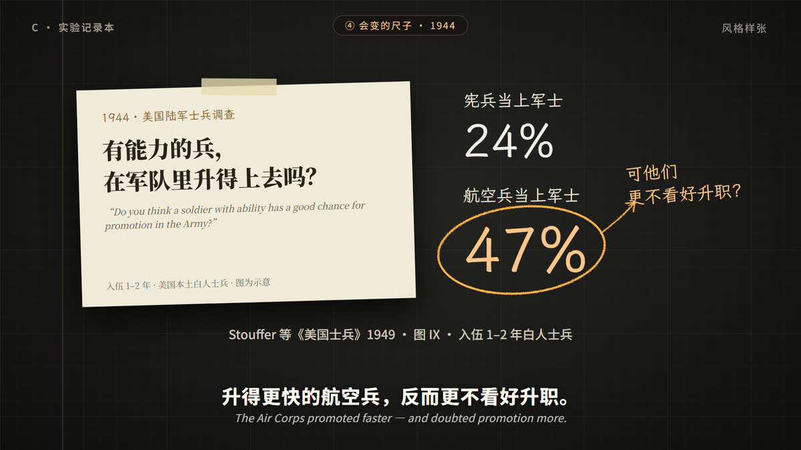

# 第二十一期 · 风格样张（P3）

> 片名《快递拆开以后，快乐去哪了？》· 2026-10-28
> **已拍板（2026-10-28）：A「夜里的房间」为主，机制段（② 实验、④ 尺子与士兵）借 C 的粉笔线和手写批注，画在同一间房里。** 英文字幕按建议去掉，只在术语首次出现时在注释带留英文原词。
> 三个方向画的是**同样两拍**，方便直接比较：
> - **主视觉**：① 冷开场「签收那一刻」：「想要」的光在派送中最亮，一直撑到签收，签收那一下落下，光飘向下一件（档案 F-2，**类比**，画面已标）。
> - **引文卡**：④「会变的尺子 · 1944」，即《美国士兵》图 IX：宪兵 24%、航空兵 47% 当上军士，航空兵却更不看好升职（档案 F-12–F-14，**图为示意**）。
>
> 三个方向共用一团暖琥珀色的光（`#ffb347`），这是全片主角，不随方向改；全部暗底高对比，不用紫调。
> 字幕带：中文 46px 粗体 ＋ 英文斜体 26px（可选，见文末）；注释带一条一句。

| 方向 | 主视觉 | 引文卡 |
|---|---|---|
| **A 夜里的房间** |  |  |
| **B 物流界面** |  |  |
| **C 实验记录本** |  |  |

## A · 夜里的房间

- **底色**：深蓝黑墙面 `#10141f`→`#07090f`，桌面一条斜线分开前后景。
- **主色**：牛皮纸箱 `#c69255` / `#8e6232`；台灯暖光打在桌面上。
- **强调色**：琥珀光 `#ffb347`，高亮 `#ffcf8a`。
- **字体**：正文 Noto Sans SC；文献复原用 Noto Serif SC。
- **气质**：深夜一个人拆快递的生活感，代入最直接。每一段都发生在同一间房里：③「房间变亮」、⑤ 的长路都可以从这里长出来，换装置不换场景。
- **代价**：写实物件多（纸箱、手机、窗、尺子、士兵），代码画的工作量最大；做不好容易像扁平插画。可以用 Codex 生图做纸箱、房间的写实贴图。

## B · 物流界面

- **底色**：近黑 `#04070a`→`#0f1d26` ＋ 青色点阵，四角 HUD 框。
- **主色**：青 `#5fd4e6`（物流轨道、已完成节点、数据条）。
- **强调色**：琥珀 `#ffb347`（「想要」曲线和光）。
- **字体**：Noto Sans SC ＋ Cascadia Mono（时间戳、英文标签）。
- **气质**：把手机里的物流页放大成一整块屏幕，最贴「快递」，也最像抖音上的「数据揭秘」，信息读得最快。
- **代价**：偏冷、偏「仪表盘」，人情味弱。② 实验、④ 士兵都要硬塞进 UI 语言里，长了容易像 PPT。

## C · 实验记录本

- **底色**：炭黑 `#1a1918` ＋ 方格纸细线，左侧一条琥珀色装订边线。
- **主色**：粉笔白 `#f2eee4`（手绘曲线、坐标轴、速写纸箱，带轻微抖动）。
- **强调色**：橙 `#ffc58a` ＋ 琥珀光。
- **字体**：标注用霞鹜文楷（手写感）；文献卡用 Noto Serif SC；字幕仍用 Noto Sans SC 粗体。
- **气质**：像有人在笔记本上一边画一边推演，最接近「会动的思想实验」，也是外部提示词想要的克制、有思想重量的那种。曲线、尺子、圈注都是手绘，转场可以「擦掉重画」。
- **代价**：最素，开场的视觉冲击比 A、B 弱，要靠光的动效和手绘动画把节奏撑起来。

## 我的建议

**A 为主，借 C 的手写批注。** 理由：

- 本片的力量在「这就是你」：深夜等快递、拆开、放进抽屉，A 是唯一能直接拍出这种生活感的方向。
- 你在第六期说过不要压抑的暗、画面要真实。A 的台灯暖光比 B 的冷屏和 C 的黑板都更贴这一条。
- 机制段（② 实验、④ 尺子）可以在 A 的房间里用 C 式的手写批注和粉笔线来画，既保住推演感，也不切换世界。

如果想要信息更快、更「数据感」，选 B；想要最克制、最像思想实验，选 C。

## 待你拍板

1. **方向**：A / B / C，或混搭（例：A 的房间 ＋ C 的手写批注）。
2. **英文字幕**：外部提示词要双语；我们规矩是「英文斜体可选」。样张里放了英文，**倾向去掉**——抖音观众基本只看中文，英文挤占画面、也拖慢阅读。只在术语首次出现时，在注释带里保留英文原词。
3. 样张里「已刷新 8 次」「下一件」这些小字只是示意，P4 再定。

## 生成方式

- 源码：[`tools/gen-frames.mjs`](tools/gen-frames.mjs)。从仓库根目录运行 `node 第二十一期/02-风格样张/tools/gen-frames.mjs [a b c]`，输出同名 `.html` 和 `.png`（1920×1080）。
- 用项目已有的本地 headless Chrome 和 Puppeteer；字体从第二十期复制到 `fonts/`（不入库），每张都检查字体已加载、注释带和字幕带不出画面。
- 全部代码自绘，没有生成图、没有外部素材。
