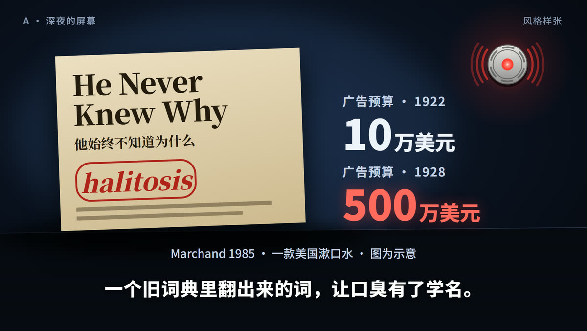
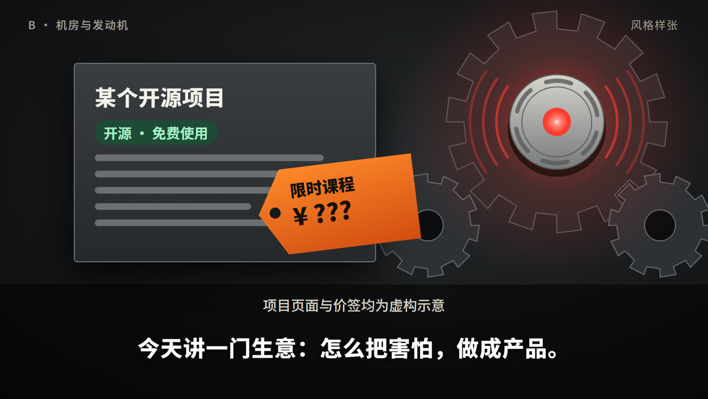
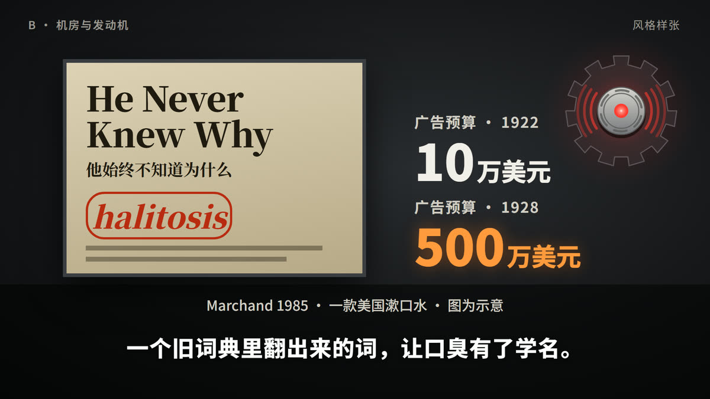
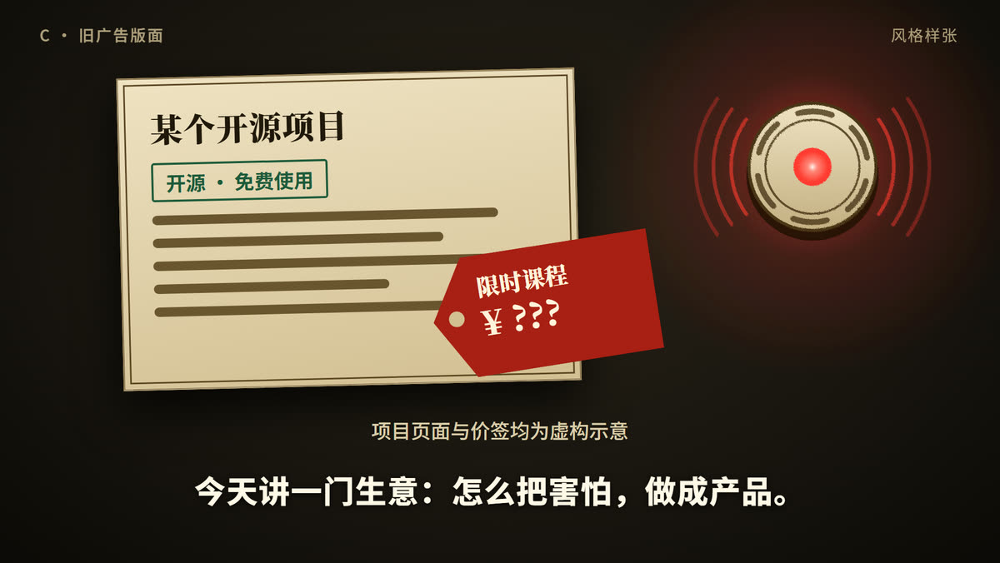
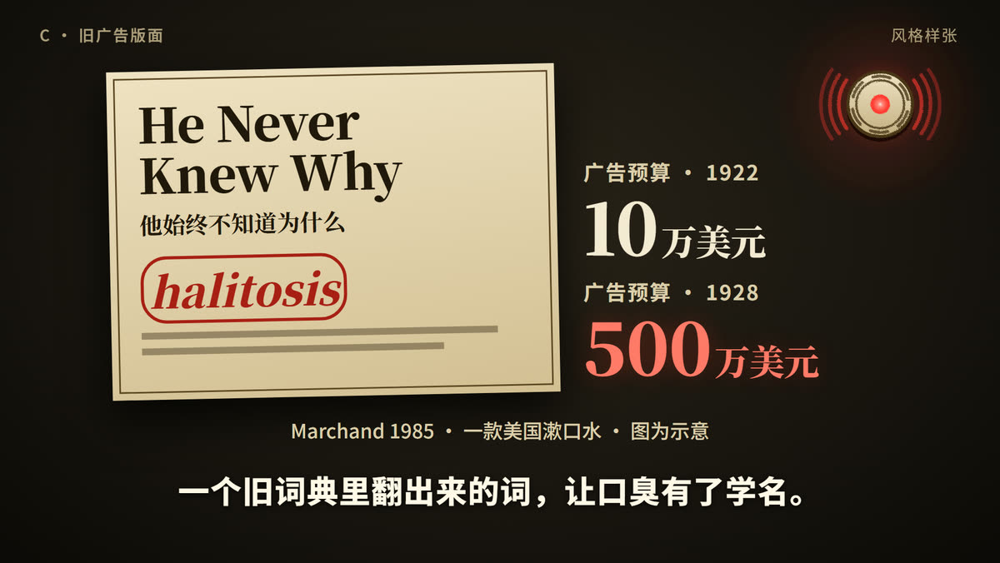

# 第二十二期 · 风格样张（P3）

> 片名《焦虑，是怎么变成一门生意的？》· 2026-11-01
> **已拍板（2026-11-01）：C「旧广告版面」为主，⑤ 的发动机借 B 的齿轮，画成同一种版画质感。**
> 三个方向画的是**同样两拍**，方便直接比较：
> - **主视觉**：① 开门见山。课程价签贴上开源项目页，报警器亮起（页面和价签均为虚构）。
> - **引文卡**：③ 1920 年代的旧广告与广告预算（档案 F-4、F-5，**图为示意**）。
>
> 三个方向共用同一个报警器造型和信号红 `#ff3b30`，这是全片主角，不随方向改；全部暗底高对比，不用紫调。
> 文字按第二十一期的尺寸：字幕 60px、注释带 38px、画内标签不小于 36px。项目页的正文用色条，不放小字。

| 方向 | 主视觉 | 引文卡 |
|---|---|---|
| **A 深夜的屏幕** |  |  |
| **B 机房与发动机** |  |  |
| **C 旧广告版面** |  |  |

## A · 深夜的屏幕

- **底色**：深蓝黑 `#16233c`→`#05070d`。
- **主色**：屏幕冷白 `#eef3fa`。
- **强调色**：信号红 `#ff3b30`，价签同色。
- **字体**：正文 Noto Sans SC；旧广告用 Noto Serif SC。
- **气质**：最贴「深夜刷到一句话」，代入最直接，现代、干净。
- **代价**：最常见，辨识度最低；1920 年代那段和今天的画面是两个世界，「一百年没变」要靠字幕说。

## B · 机房与发动机

- **底色**：炭黑 `#2a2c30`→`#0b0b0d`。
- **主色**：金属灰 `#3a3d42`、齿轮描边 `#63666c`。
- **强调色**：暖橙 `#ff8a2b`、信号红。
- **字体**：Noto Sans SC；旧广告用 Noto Serif SC。
- **气质**：机械感最强，⑤ 的发动机会非常有冲击力，也最适合做 3D。
- **代价**：偏冷、偏硬，人情味弱；现状和历史段要硬塞进机房。

## C · 旧广告版面

- **底色**：深墨 `#2a2319`→`#0c0a07`。
- **主色**：泛黄旧报 `#efe2c3`、墨色 `#20180b`。
- **强调色**：朱红 `#a81f14`、信号红。
- **字体**：标题 Noto Serif SC 粗体；字幕仍用 Noto Sans SC 粗体。
- **气质**：把今天的项目页和课程也印成一百年前的广告，**画面本身就在说「这套流程没变过」**，辨识度最高。
- **代价**：今天的 AI 话题穿旧衣服，要防止看起来只是在讲历史；⑤ 的发动机要画成版画风，工作量不小。

## 我的建议

**C 为主，⑤ 的发动机借 B 的齿轮，但画成同一种版画质感。** 理由：

- 片子最有力的一句是「一百年前就是这个流程」，只有 C 能用画面直接说出来，不用靠字幕解释。
- 抖音上深色界面风的科普很多，旧报纸加一个闪红灯的报警器，第一眼更容易记住。
- 暖色的旧纸比 A、B 的冷色更透气，也更接近第六期说过的「不要压抑的暗」。

如果想要更现代、更直接的代入感，选 A；如果最看重发动机那一段的冲击力，选 B。

## 待你拍板

1. **方向**：A / B / C，或混搭（推荐 C ＋ B 的齿轮）。
2. 样张里的「限时课程」「¥ ???」和字幕都只是示意，文案到 P4 再定。

## 生成方式

- 源码：[`tools/gen-frames.mjs`](tools/gen-frames.mjs)。从仓库根目录运行 `node 第二十二期/02-风格样张/tools/gen-frames.mjs [a b c]`，输出同名 `.html` 和 `.png`（1920×1080）。
- 用项目已有的本地 headless Chrome 和 Puppeteer；字体从第二十一期复制到 `fonts/`（不入库），脚本会检查注释带和字幕带不出画面。
- 全部代码自绘，没有生成图、没有外部素材。「He Never Knew Why」是档案 F-4 记载的广告标题，版面是示意复原，不是原广告。
