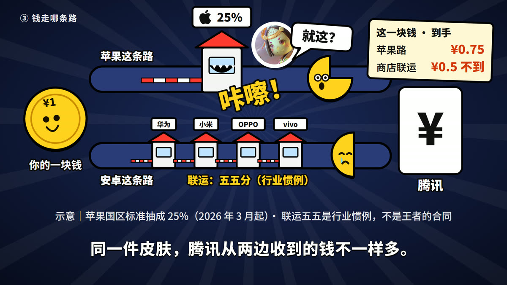
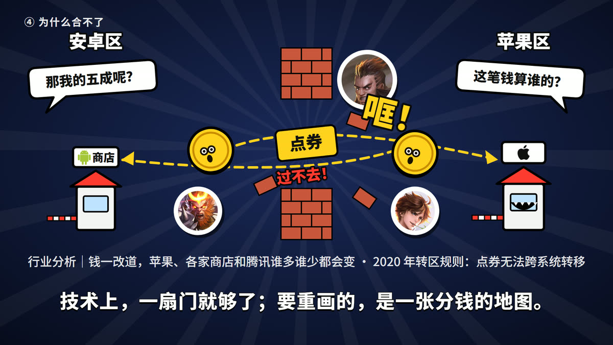
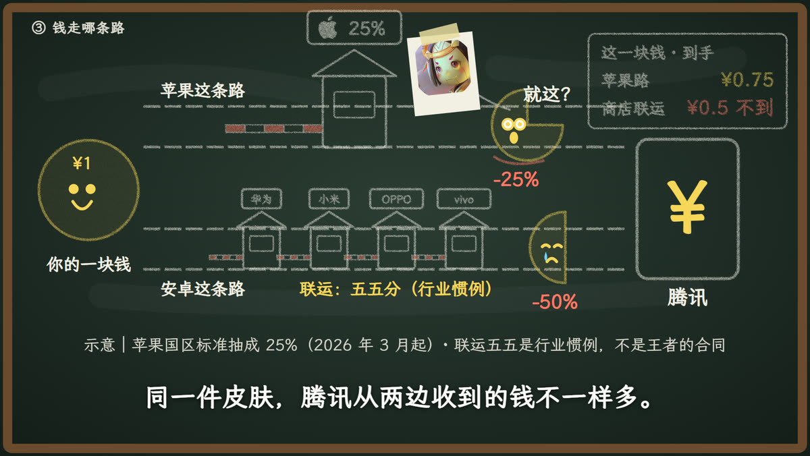
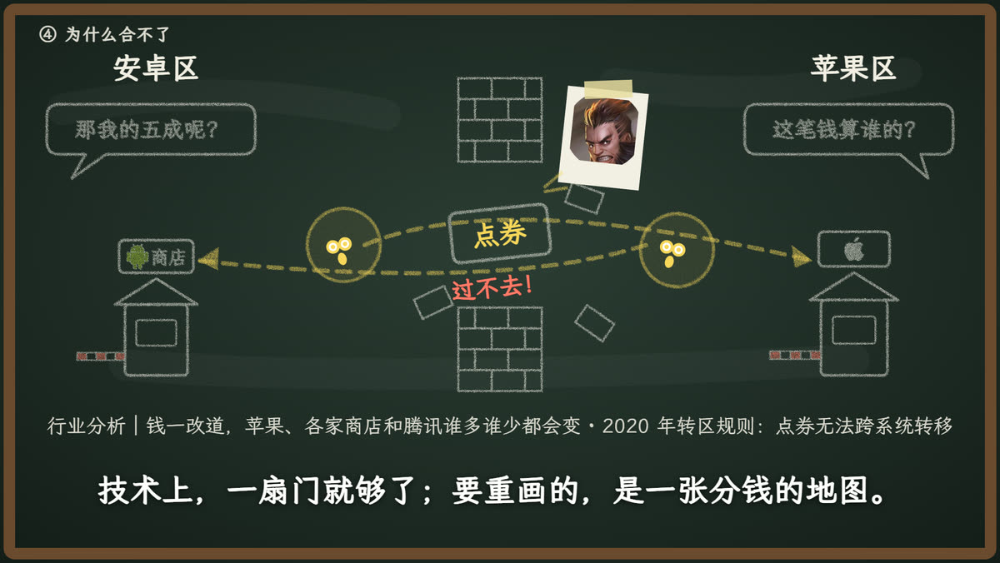
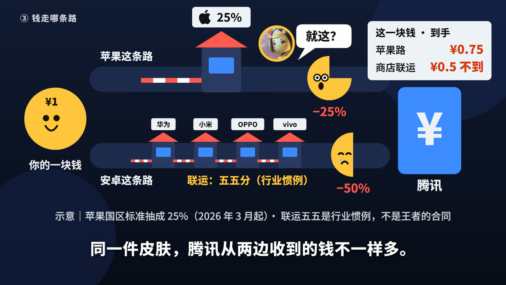
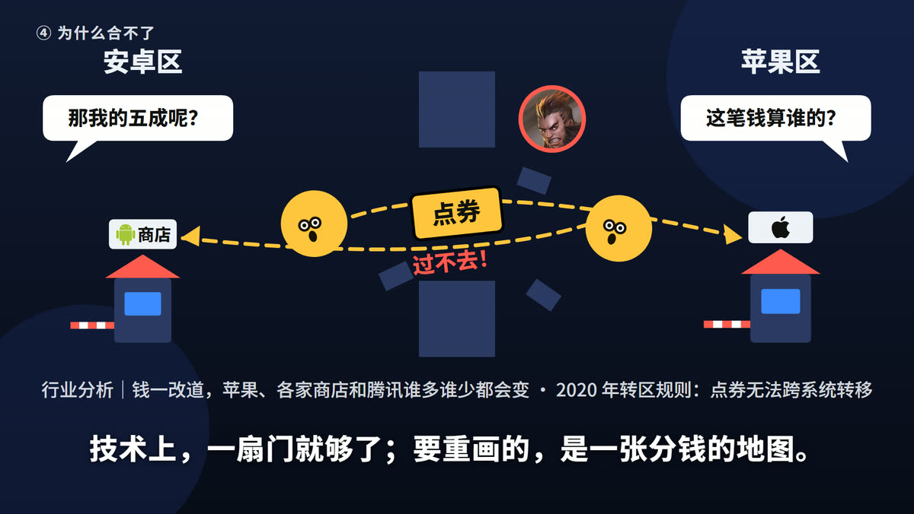

# 第二十四期 · 风格样张（P3）

> 片名《王者荣耀，为什么不合区？》· 2026-11-03
> **已拍板（2026-11-03）：A「表情包拼贴」为主，借鉴 C 的干净排版（账单、数字、注释）。**
> 三个方向画的是**同样两拍**，方便直接比较：
> - **拍一 pipes**：③ 同样一块钱走两条路。苹果国区标准抽成 25%（档案 F-9），安卓应用商店联运五五为行业惯例（F-10），画面标「示意」。
> - **拍二 remap**：④ 一合区，分钱的地图就得重画。钱改道奔向对面的收费站，点券卡在墙洞里过不去（F-5、F-10–F-13），画面标「行业分析」。
>
> 三个方向共用同一个主角：**一枚有表情的一块钱硬币**，被抽成时按真实比例缺掉一块（25% / 50%），不画密集的小图标。右上角是贯穿全片的小账单。
> 文字按第二十一期以来的尺寸：字幕 60px、注释带 38px、画内标签不小于 36px。全部暗底高对比，不用紫调。
> 生成：`node 第二十四期/02-风格样张/tools/gen-frames.mjs [a b c]`（从仓库根目录运行）。

| 方向 | 拍一：两条收费管道 | 拍二：重画分钱地图 |
|---|---|---|
| **A 表情包拼贴** |  |  |
| **B 黑板涂鸦** |  |  |
| **C 扁平几何** |  |  |

## A · 表情包拼贴（推荐）

- **底色**：深蓝 `#1b2a5c`→`#070b1c`，加漫画式放射线（粗条，不用网点）。
- **主色**：硬币黄 `#ffd21f`，粗黑描边 `#0a0a0a`，白色贴纸。
- **强调色**：信号红 `#ff3b30`（收费站、栏杆、亏损数字）。
- **字体**：Noto Sans SC 900，标题字加黑描边。
- **英雄**：圆形贴纸，白边加投影，可以歪着贴；收费站的窗口变成会咬人的嘴；拟声大字「咔嚓！」「哐！」。
- **气质**：最接近「抽象」：一本正经的商业数字，配上发疯的表情包画面，反差最大，也最像抖音的梗视频。
- **代价**：画面最满、最吵，内容多的拍子要控制元素数量；英雄贴纸用多了会像拼贴海报，每拍最多两三张。

## B · 黑板涂鸦

- **底色**：黑板绿 `#2c3d35`→`#121a16`，木框，留一点没擦干净的粉笔痕。
- **主色**：粉笔白 `#f3efe4`。
- **强调色**：粉笔黄 `#f7d65a`、粉笔红 `#ff7a68`。
- **字体**：霞鹜文楷（WenKai）。
- **英雄**：胶带贴在黑板上的照片。
- **气质**：像老师在黑板上讲一堂商业课，「专业分析」的味道最足，也最耐看。
- **代价**：笑点要靠动作和拟音，画面本身不够「抽象」；粉笔线条偏细，手机上的可读性要再验；暗绿底和游戏原画的高饱和色有些打架。

## C · 扁平几何

- **底色**：深海军蓝 `#111a33`→`#080c18`，几块大圆当背景。
- **主色**：硬币黄 `#ffc53d`、亮蓝 `#3d8bff`。
- **强调色**：珊瑚红 `#ff5a4e`、安卓绿 `#3ddc84`。
- **字体**：Noto Sans SC 800。
- **英雄**：圆形头像加色环。
- **气质**：干净的信息图，最好读、最好做动画，也最像财经类视频。
- **代价**：最常见，辨识度最低；搞笑全靠运动设计，静帧不好笑。

## 我的建议

**选 A 为主**，并借用 C 的干净排版来画账单和数字（让「专业」那一半站得住）。理由是用户要的是「抽象、搞笑」，A 的静帧就已经好笑；B 的黑板感可以留给 ⑤ 收费站地图那一拍，作为一处「讲课」的变调，也可以不借。

## 素材与出处

- **英雄原画**：腾讯官方 CDN 的英雄皮肤大图（`game.gtimg.cn/images/yxzj/img201606/skin/hero-info/<id>/<id>-bigskin-1.jpg`），英雄列表来自 `pvp.qq.com/web201605/js/herolist.json`。本样张用到鲁班七号（112）、程咬金（144）、孙悟空（167）、李白（131）；圆形头像是从原画裁的，不是抠图。**用户已授权使用网上的游戏素材（2026-11-03），风险由用户判断。** 文件在 `素材/`，不入库。
- **logo**：苹果标志 [Wikimedia Commons: Apple_logo_black.svg](https://commons.wikimedia.org/wiki/File:Apple_logo_black.svg)；安卓机器人 [Wikimedia Commons: Android_robot.svg](https://commons.wikimedia.org/wiki/File:Android_robot.svg)（Google 发布，CC BY 3.0）。华为、小米、OPPO、vivo 只用文字。
- **P5 要补的**：英雄全身抠图（让英雄做动作，而不只是头像）、王者荣耀 logo。抠图优先用本机 ComfyUI 的去背景节点。
- **账单数字是示意**：¥0.75 只算苹果标准抽成，没扣税费和支付通道费；「¥0.5 不到」对应「五五分在扣除通道费之后算」（F-10）。正片注释带要写清。
